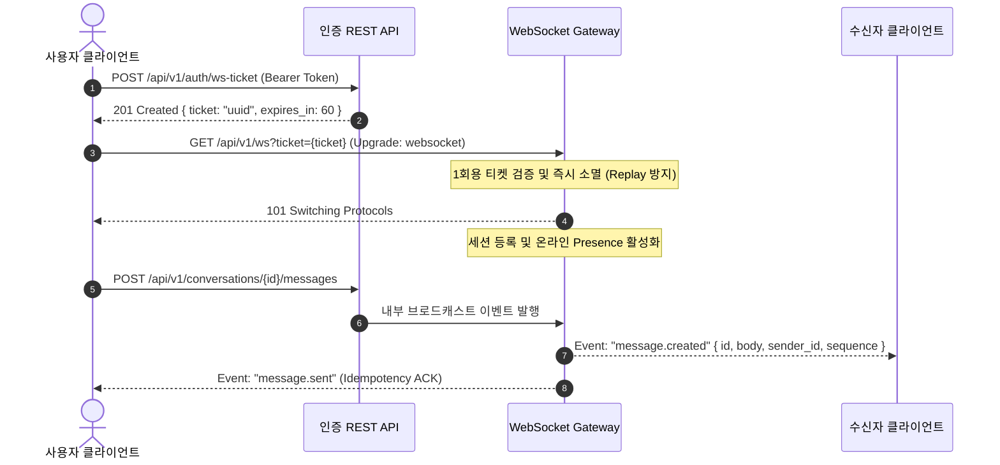

# ⚡ MESSENGER REALTIME ENGINE REPORT

## 1. Realtime Engine Architecture

본 플랫폼은 고성능 양방향 실시간 메시징을 위해 두 가지 상호 보완적인 런타임 엔진을 지원합니다:
1. **Cloudflare Edge Worker WebSocketPair**: Anycast 글로벌 300+ 엣지 로케이션에서 클라이언트와 직접 종단되는 초저지연 WebSocket 프록시.
2. **Go Backend Gorilla WebSocket Gateway**: 온프레미스 / VPC 환경에서 구동되는 고효율 네이티브 Go 고루틴 기반 세션 브로드캐스터.

---

## 2. Realtime Ticket Security & Handshake Lifecycle

---

## 3. Realtime Protocol Events Specification

- `message.created`: 새 메시지 수신 알림 (텍스트, 스티커, 첨부파일, 송금 등)
- `message.unsent`: 24시간 이내 발송 취소 동기화
- `message.reaction`: 6종 이모지 감정 표현 추가/삭제
- `conversation.read`: 상대방이 특정 시퀀스까지 읽었음을 알리는 읽음 수신 확인 (Read Receipt)
- `conversation.typing`: 상대방의 키보드 입력 작성 중 인디케이터 (3초 디바운싱)
- `conversation.pins`: 대화방 공지 핀 변경 브로드캐스트
- `poll.updated`: 투표 생성, 투표 참여, 투표 마감 상태 동기화
- `call.ringing`: 1:1 또는 그룹 수신 전화 알림
- `call.signal`: WebRTC SDP Offer/Answer 및 ICE Candidate 릴레이
- `call.state`: 통화 연결(`connected`), 음소거(`muted`), 종료(`ended`) 상태 전이
