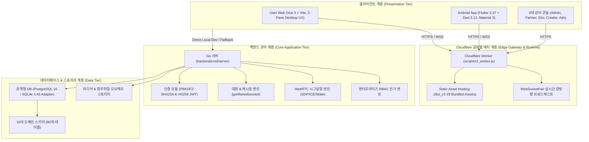

# 🏗️ MESSENGER SYSTEM ARCHITECTURE

## 1. System Topology & Architecture Overview

---

## 2. 계층별 아키텍처 상세

### 2.1 클라이언트 계층 (Presentation Tier)
- **User Web ([`apps/user-web`](file:///c:/Users/dnjst/Desktop/project/line/apps/user-web))**:
  - 카카오톡 스타일을 배제하고 오리지널 LINE 고유의 **3단 분할 데스크톱 UX** 구축 (68px 독 + 320px 리스트 패널 + 메인 워크스페이스).
  - 공식 LINE 그린(`#06C755`) 테마와 슬레이트 블루 대화 배경(`849ebf`), 화이트 수신/그린 발신 말풍선 꼬리표 및 `읽음` 인디케이터.
- **모바일 클라이언트 ([`mobile/flutter_app`](file:///c:/Users/dnjst/Desktop/project/line/mobile/flutter_app))**:
  - Flutter 3.47.8 기반 크로스 플랫폼 클라이언트.
  - Android SDK 36.0.0 타겟 릴리즈 APK 패키징 완료 (`Messenger-Android-v1.0.0-release.apk`).
- **5대 관리자/비즈니스 콘솔**:
  - 슈퍼 관리자(`admin`), 파트너(`partner`), 개발자(`developer`), 크리에이터(`creator`), 광고주(`ads`) 콘솔.

### 2.2 Cloudflare 에지 계층 (Edge Gateway & Runtime)
- **런타임**: Cloudflare Workers Anycast 글로벌 에지 네트워크.
- **실시간 통신**: Cloudflare 네이티브 `WebSocketPair` API를 통한 초저지연 WebSocket 양방향 브로드캐스트.
- **보안 및 정합성**: 단일 사용(One-use) 60초 만료 WebSocket 티켓 인증, 대화방 멤버십 하위 리소스 격리 강제.

### 2.3 백엔드 코어 계층 (Core Tier)
- **Go 1.27 코어 서버**:
  - 고성능 경량 백엔드 아키텍처 (`internal/auth`, `internal/db`, `internal/server`).
  - WebRTC 시그널링(SDP Offer/Answer, ICE Candidate exchange) 및 QoS 품질 텔레메트리 수집.

### 2.4 데이터베이스 계층 (Data Tier)
- **16개 도메인 관계형 스키마 ([`database/001_all_phases.sql`](file:///c:/Users/dnjst/Desktop/project/line/database/001_all_phases.sql))**:
  - `identity`, `social`, `chat`, `realtime`, `calling`, `crypto`, `community`, `business`, `developer`, `creator`, `commerce`, `ads`, `safety`, `ops` 등 총 80개 테이블 구성.
