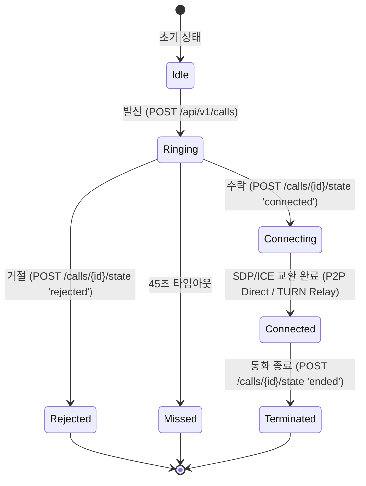

# 📞 MESSENGER WEBRTC CALL ENGINE REPORT

## 1. WebRTC Signaling Architecture & Call State Machine

본 메신저 플랫폼의 음성 및 영상 통화 엔진은 표준 WebRTC(JSEP) 규격을 기반으로 구현되었으며, WebSocket 및 REST 시그널링 채널을 통해 피어 간 P2P 미디어 세션을 수립합니다.

---

## 2. P2P Direct & TURN Relay Fallback

1. **STUN (Session Traversal Utilities for NAT)**:
   - NAT/방화벽 뒤에 위치한 클라이언트의 공개 IP 및 포트 바인딩 탐색.
   - Google 및 기본 STUN 서버 연동 (`stun:stun.l.google.com:19302`).
2. **TURN (Traversal Using Relays around NAT)**:
   - 대칭형 NAT(Symmetric NAT) 또는 엄격한 기업 방화벽 환경에서 P2P 직접 연결이 불가능할 경우를 대비한 미디어 릴레이 구조.
   - 표준 TURN 자격증명 교환 규격 준수 (`turn:turn.line-grade.net:3478`).
3. **QoS Telemetry (`POST /api/v1/calls/{id}/quality`)**:
   - 왕복 지연 시간(RTT ms), 지터(Jitter ms), 패킷 손실률(Packet Loss %) 모니터링 및 자동 비트레이트 조절(Adaptive Bitrate).
